# MOSS-Image Layout Cookbook

Twelve copy-paste layout JSON examples for [MOSS-Image](https://github.com/OpenMOSS/MOSS-Image), the open-source text-to-image model from OpenMOSS. Each one comes with the exact file and the image it produced. Nothing is retouched: when an image came out wrong, the layout was rewritten and generated again.

**Try them in your browser:** [mossimage.studio/layout](https://mossimage.studio/layout?utm_source=github&utm_medium=referral&utm_campaign=layout_cookbook), a free-to-try visual editor with no ComfyUI and no model weights to download.

> Unofficial community project, not affiliated with OpenMOSS.

## Examples

<table>
<tr>
<td align="center" valign="top" width="33%"><a href="examples/jazz-night-poster">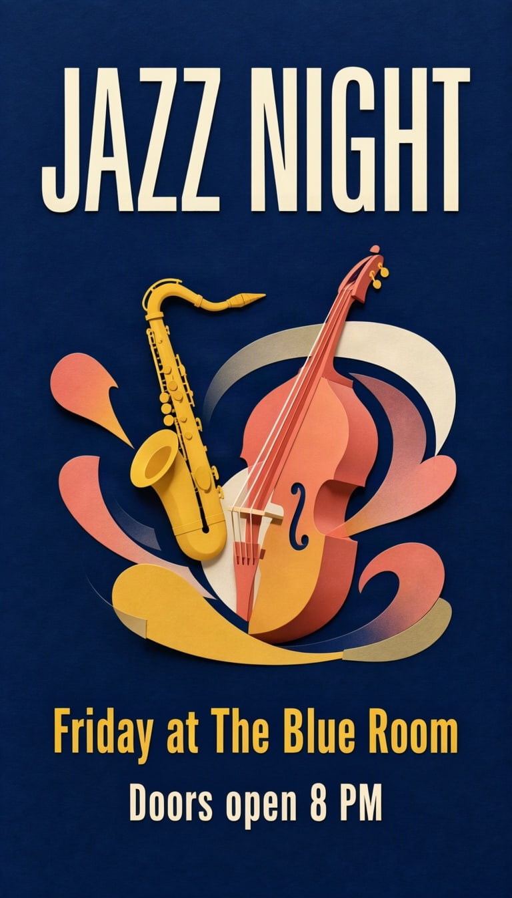</a><br><a href="examples/jazz-night-poster">Jazz night poster</a></td>
<td align="center" valign="top" width="33%"><a href="examples/summer-sale-flyer">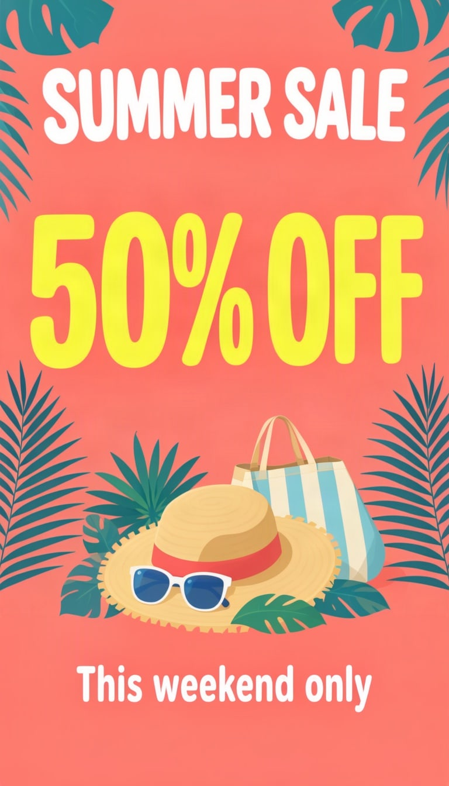</a><br><a href="examples/summer-sale-flyer">Summer sale flyer</a></td>
<td align="center" valign="top" width="33%"><a href="examples/book-cover">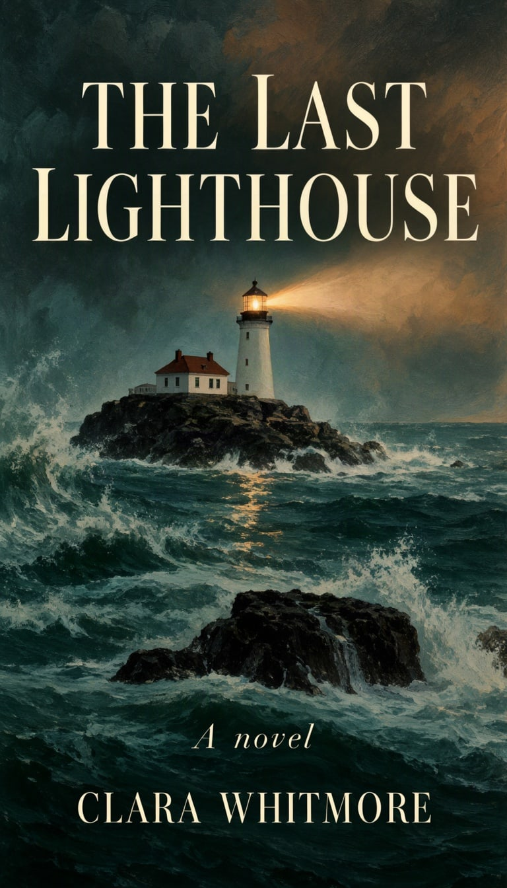</a><br><a href="examples/book-cover">Book cover</a></td>
</tr>
<tr>
<td align="center" valign="top" width="33%"><a href="examples/honey-jar-label">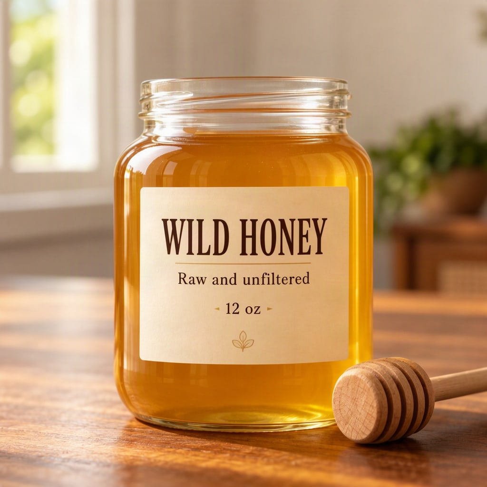</a><br><a href="examples/honey-jar-label">Honey jar product shot</a></td>
<td align="center" valign="top" width="33%"><a href="examples/quote-card">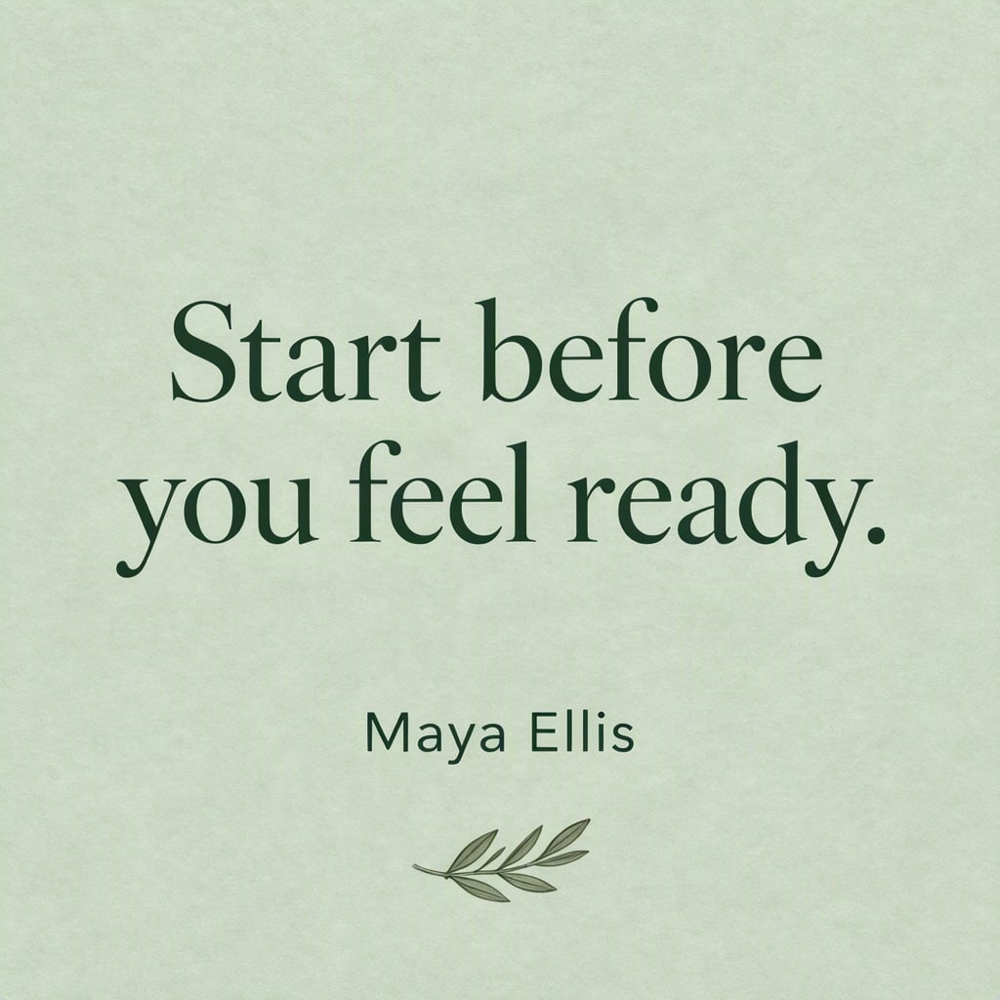</a><br><a href="examples/quote-card">Quote card</a></td>
<td align="center" valign="top" width="33%"><a href="examples/motorcycle-tshirt">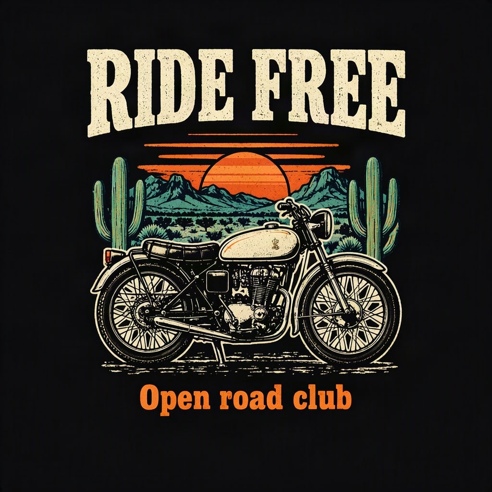</a><br><a href="examples/motorcycle-tshirt">T-shirt graphic</a></td>
</tr>
<tr>
<td align="center" valign="top" width="33%"><a href="examples/cafe-menu">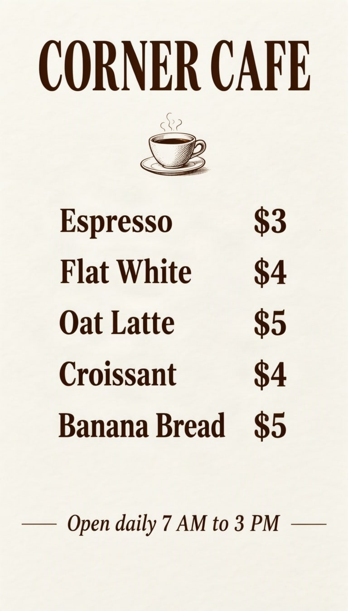</a><br><a href="examples/cafe-menu">Cafe menu</a></td>
<td align="center" valign="top" width="33%"><a href="examples/wedding-invitation">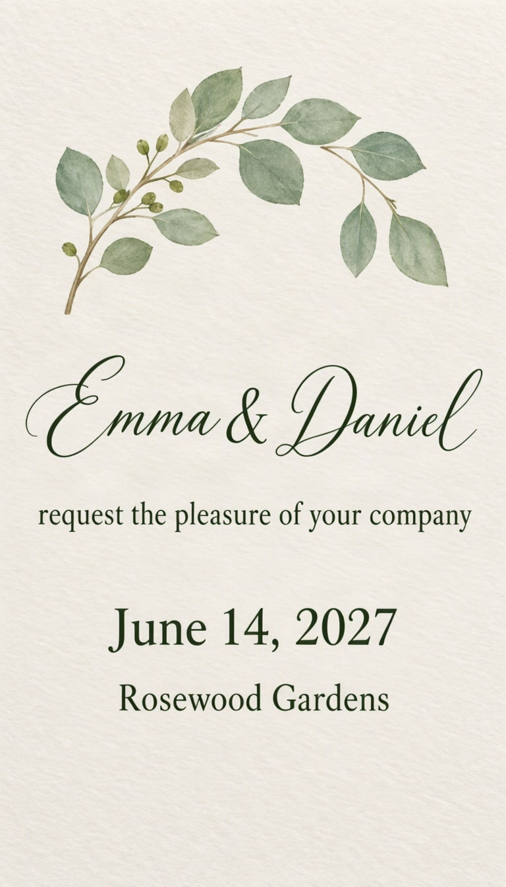</a><br><a href="examples/wedding-invitation">Wedding invitation</a></td>
<td align="center" valign="top" width="33%"><a href="examples/coffee-infographic">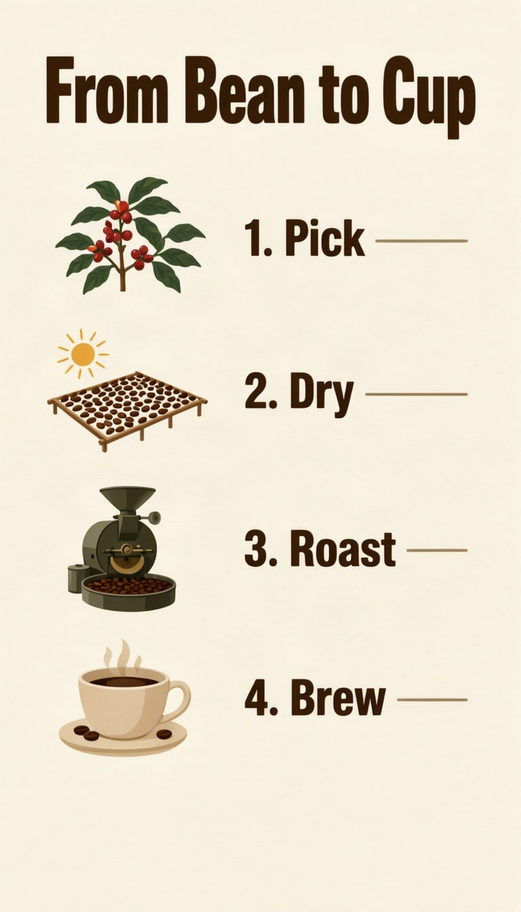</a><br><a href="examples/coffee-infographic">Step-by-step infographic</a></td>
</tr>
<tr>
<td align="center" valign="top" width="33%"><a href="examples/youtube-thumbnail">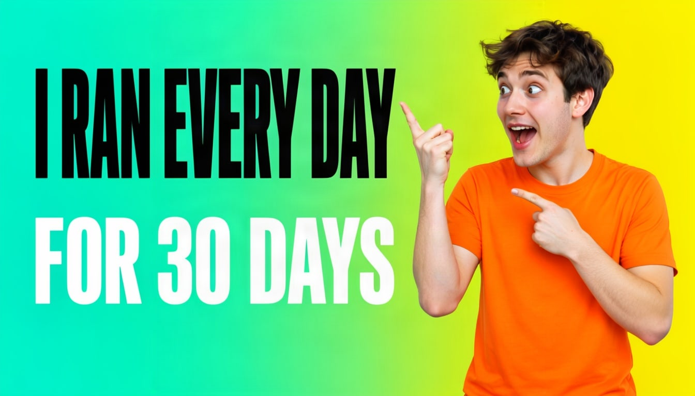</a><br><a href="examples/youtube-thumbnail">YouTube thumbnail</a></td>
<td align="center" valign="top" width="33%"><a href="examples/conference-banner"></a><br><a href="examples/conference-banner">Conference banner</a></td>
<td align="center" valign="top" width="33%"><a href="examples/sleep-tips-post">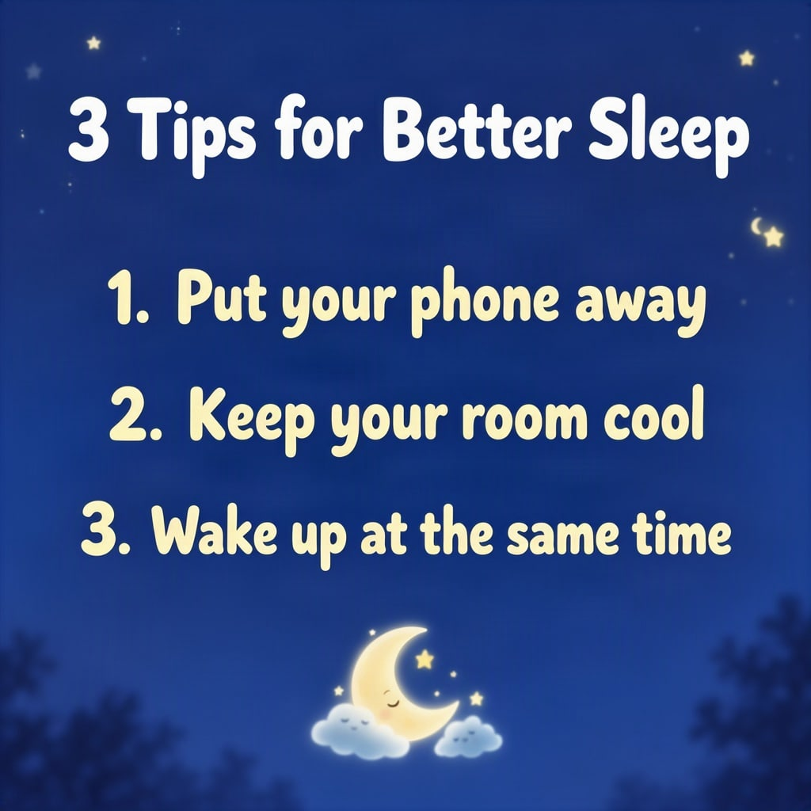</a><br><a href="examples/sleep-tips-post">Tips list for social media</a></td>
</tr>
</table>

Looking for plain prompts instead? See the [text prompt examples](prompts/README.md).

## Layout JSON in five minutes

MOSS-Image can read a JSON layout instead of a sentence: you say what goes where. This is the shape, from the [official user guide](https://github.com/OpenMOSS/MOSS-Image/blob/main/USERGUIDE.md):

```json
{
  "summary": {
    "meta": ["poster"],
    "canvas": "single",
    "caption": "A minimalist travel poster with a cream background and a blue mountain illustration."
  },
  "items": [
    {
      "label": "text",
      "caption": "Large dark-blue uppercase title.",
      "text": "EXPLORE",
      "bbox": [-416, -384, -288, 384]
    },
    {
      "label": "object",
      "caption": "A flat blue mountain illustration.",
      "bbox": [-192, -288, 384, 288]
    }
  ],
  "bbox_coord_space": "abs_centralized",
  "bbox_format": "yxyx"
}
```

| Field | Meaning |
| --- | --- |
| `summary.caption` | The whole image: scene, style, colours, mood. |
| `items[].label` | `text`, `object` or `character`. |
| `items[].caption` | What this box looks like. |
| `items[].text` | The exact words to draw. Text boxes only. |
| `items[].bbox` | The box, as `[y_min, x_min, y_max, x_max]`. |

### The coordinates

`abs_centralized` means pixels measured from the **centre** of the canvas, so the top-left corner of a 1024 × 1024 image is `y = -512, x = -512`. `yxyx` means y comes first.

To convert a box you measured from the top-left corner:

```text
y_centred = y - height / 2
x_centred = x - width / 2
```

So on a 1024 × 1024 canvas, a box from (x 128, y 96) to (x 896, y 224) becomes `[-416, -384, -288, 384]`.

| Ratio | Canvas | y range | x range |
| --- | --- | --- | --- |
| 1:1 | 1024 × 1024 | -512 to 512 | -512 to 512 |
| 16:9 | 1344 × 768 | -384 to 384 | -672 to 672 |
| 9:16 | 768 × 1344 | -672 to 672 | -384 to 384 |

## What we learned making these

- **One box per line of text.** You choose the line breaks instead of the model. See the [quote card](examples/quote-card) and the [menu](examples/cafe-menu).
- **Keep position words out of captions.** A caption that says "at the top" can override a box you moved. The box already says where; the caption should only say what.
- **Thick outlines cost you letters.** The first [thumbnail](examples/youtube-thumbnail) used a heavy outline and "EVERY" came out with its letters fused. Plain heavy type fixed it.
- **Ask for no logos.** A plain "running shirt" came back with a sportswear-style mark, and the first motorcycle had a badge on its tank. "Plain, no logos" in the caption solved both.
- **Check every word.** Models still misspell. Read the output before you use it.

## Run them

**In a browser.** Open the [layout editor](https://mossimage.studio/layout?utm_source=github&utm_medium=referral&utm_campaign=layout_cookbook), pick the example's ratio first, choose **Import JSON** and paste `layout.json`. You can drag the boxes before you generate. Generating needs a free account.

**With the fal API.** This generates one example and saves `generated.jpg` next to it. It needs Node 18 or newer and a [fal](https://fal.ai) key, and fal charges for each image. When we reran an example this way, with its seed and settings, we got the same image back.

```bash
FAL_KEY=your-key node scripts/generate.mjs examples/quote-card
```

**Locally.** See the [official user guide](https://github.com/OpenMOSS/MOSS-Image/blob/main/USERGUIDE.md). Results will differ from the images here, since a seed only repeats on the same setup.

The settings for each image are in its `settings.json`.

## Contributing

New examples are welcome. Please include the `layout.json`, the `settings.json` and the unedited output.

## License

Code, layouts and text are under the [MIT License](LICENSE). Images are under [CC BY 4.0](LICENSE-IMAGES.md). MOSS-Image itself is [licensed by OpenMOSS](https://github.com/OpenMOSS/MOSS-Image#license).

Made by [MossImage Studio](https://mossimage.studio/?utm_source=github&utm_medium=referral&utm_campaign=layout_cookbook).
