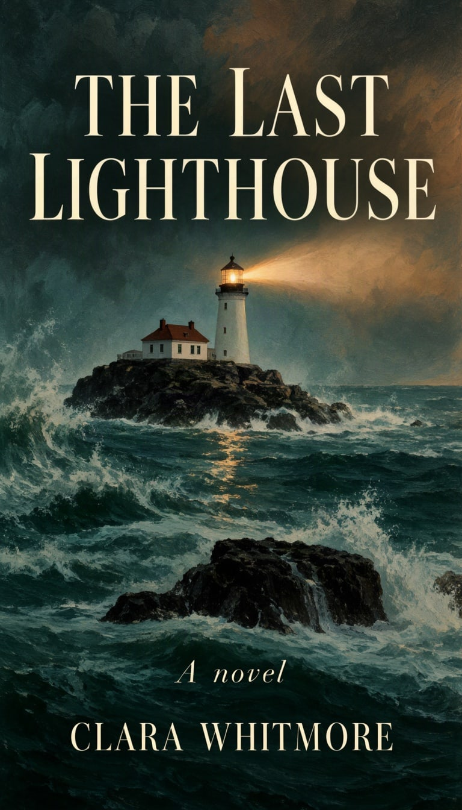

# Book cover



Title, author and one strong image. An object box in the middle keeps the art away from the type.

| Canvas | Ratio | Seed | Steps | Guidance |
| --- | --- | --- | --- | --- |
| 768 × 1344 | 9:16 | 1110 | 50 | 3 |

[Open the layout editor](https://mossimage.studio/layout?utm_source=github&utm_medium=referral&utm_campaign=layout_cookbook), pick 9:16, choose **Import JSON** and paste this:

```json
{
  "summary": {
    "meta": [
      "book cover"
    ],
    "canvas": "single",
    "caption": "A moody literary novel cover with a stormy teal sea, a dark sky and warm light, painted in rich oil brushstrokes."
  },
  "items": [
    {
      "label": "text",
      "caption": "Large cream elegant serif uppercase title.",
      "text": "THE LAST LIGHTHOUSE",
      "bbox": [
        -576,
        -336,
        -304,
        336
      ]
    },
    {
      "label": "object",
      "caption": "A lone white lighthouse on black rocks with a warm beam cutting through the storm.",
      "bbox": [
        -256,
        -272,
        384,
        272
      ]
    },
    {
      "label": "text",
      "caption": "Small italic cream serif line.",
      "text": "A novel",
      "bbox": [
        416,
        -112,
        472,
        112
      ]
    },
    {
      "label": "text",
      "caption": "Medium cream serif uppercase author name.",
      "text": "CLARA WHITMORE",
      "bbox": [
        512,
        -272,
        592,
        272
      ]
    }
  ],
  "bbox_coord_space": "abs_centralized",
  "bbox_format": "yxyx"
}
```
