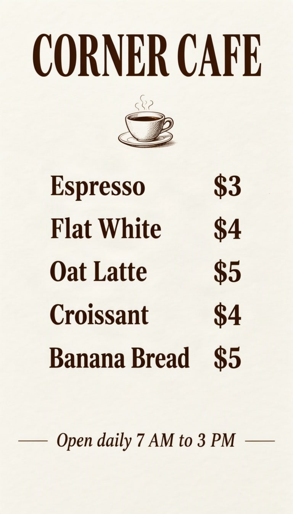

# Cafe menu



Each line of a menu gets its own text box, so prices line up. Keep lines short and the spacing even.

| Canvas | Ratio | Seed | Steps | Guidance |
| --- | --- | --- | --- | --- |
| 768 × 1344 | 9:16 | 1102 | 50 | 3 |

[Open the layout editor](https://mossimage.studio/layout?utm_source=github&utm_medium=referral&utm_campaign=layout_cookbook), pick 9:16, choose **Import JSON** and paste this:

```json
{
  "summary": {
    "meta": [
      "menu"
    ],
    "canvas": "single",
    "caption": "A clean cafe menu printed on warm off-white paper with dark brown serif type and a small line drawing of a coffee cup."
  },
  "items": [
    {
      "label": "text",
      "caption": "Large dark brown serif title.",
      "text": "CORNER CAFE",
      "bbox": [
        -592,
        -304,
        -464,
        304
      ]
    },
    {
      "label": "object",
      "caption": "A small hand-drawn line illustration of a steaming coffee cup.",
      "bbox": [
        -432,
        -80,
        -288,
        80
      ]
    },
    {
      "label": "text",
      "caption": "Dark brown serif menu line.",
      "text": "Espresso  $3",
      "bbox": [
        -224,
        -256,
        -144,
        256
      ]
    },
    {
      "label": "text",
      "caption": "Dark brown serif menu line.",
      "text": "Flat White  $4",
      "bbox": [
        -112,
        -256,
        -32,
        256
      ]
    },
    {
      "label": "text",
      "caption": "Dark brown serif menu line.",
      "text": "Oat Latte  $5",
      "bbox": [
        0,
        -256,
        80,
        256
      ]
    },
    {
      "label": "text",
      "caption": "Dark brown serif menu line.",
      "text": "Croissant  $4",
      "bbox": [
        112,
        -256,
        192,
        256
      ]
    },
    {
      "label": "text",
      "caption": "Dark brown serif menu line.",
      "text": "Banana Bread  $5",
      "bbox": [
        224,
        -256,
        304,
        256
      ]
    },
    {
      "label": "text",
      "caption": "Small italic dark brown serif line.",
      "text": "Open daily 7 AM to 3 PM",
      "bbox": [
        448,
        -240,
        512,
        240
      ]
    }
  ],
  "bbox_coord_space": "abs_centralized",
  "bbox_format": "yxyx"
}
```
