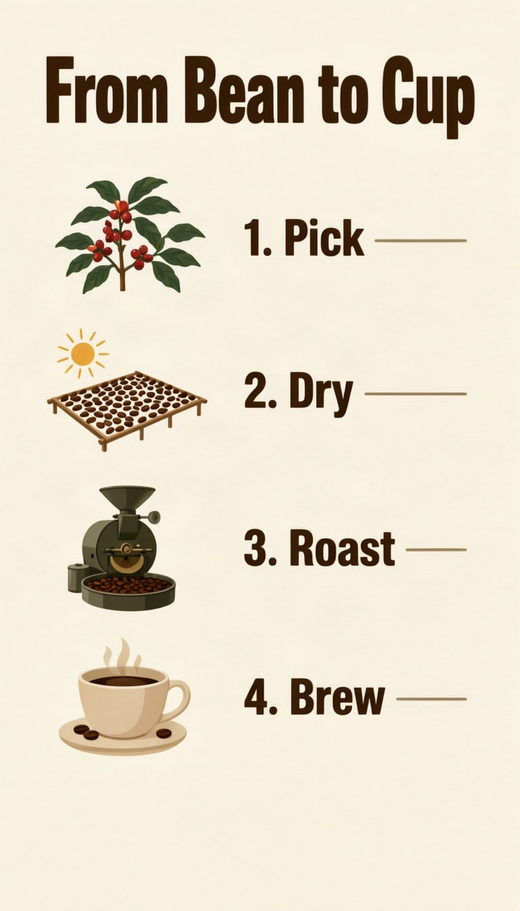

# Step-by-step infographic



Pair each small picture with its own label. Four steps is plenty: this is the most demanding layout here.

| Canvas | Ratio | Seed | Steps | Guidance |
| --- | --- | --- | --- | --- |
| 768 × 1344 | 9:16 | 1112 | 50 | 3 |

[Open the layout editor](https://mossimage.studio/layout?utm_source=github&utm_medium=referral&utm_campaign=layout_cookbook), pick 9:16, choose **Import JSON** and paste this:

```json
{
  "summary": {
    "meta": [
      "infographic"
    ],
    "canvas": "single",
    "caption": "A simple flat infographic on warm cream paper with small brown and green illustrations and dark brown sans-serif type."
  },
  "items": [
    {
      "label": "text",
      "caption": "Large dark brown bold title.",
      "text": "From Bean to Cup",
      "bbox": [
        -608,
        -320,
        -464,
        320
      ]
    },
    {
      "label": "object",
      "caption": "A flat illustration of a coffee plant branch with red cherries.",
      "bbox": [
        -416,
        -304,
        -240,
        -80
      ]
    },
    {
      "label": "text",
      "caption": "Medium dark brown line.",
      "text": "1. Pick",
      "bbox": [
        -368,
        -32,
        -288,
        304
      ]
    },
    {
      "label": "object",
      "caption": "A flat illustration of coffee beans drying on a rack in the sun.",
      "bbox": [
        -192,
        -304,
        -16,
        -80
      ]
    },
    {
      "label": "text",
      "caption": "Medium dark brown line.",
      "text": "2. Dry",
      "bbox": [
        -144,
        -32,
        -64,
        304
      ]
    },
    {
      "label": "object",
      "caption": "A flat illustration of a round coffee roaster machine.",
      "bbox": [
        32,
        -304,
        208,
        -80
      ]
    },
    {
      "label": "text",
      "caption": "Medium dark brown line.",
      "text": "3. Roast",
      "bbox": [
        80,
        -32,
        160,
        304
      ]
    },
    {
      "label": "object",
      "caption": "A flat illustration of a steaming cup of coffee.",
      "bbox": [
        256,
        -304,
        432,
        -80
      ]
    },
    {
      "label": "text",
      "caption": "Medium dark brown line.",
      "text": "4. Brew",
      "bbox": [
        304,
        -32,
        384,
        304
      ]
    }
  ],
  "bbox_coord_space": "abs_centralized",
  "bbox_format": "yxyx"
}
```
