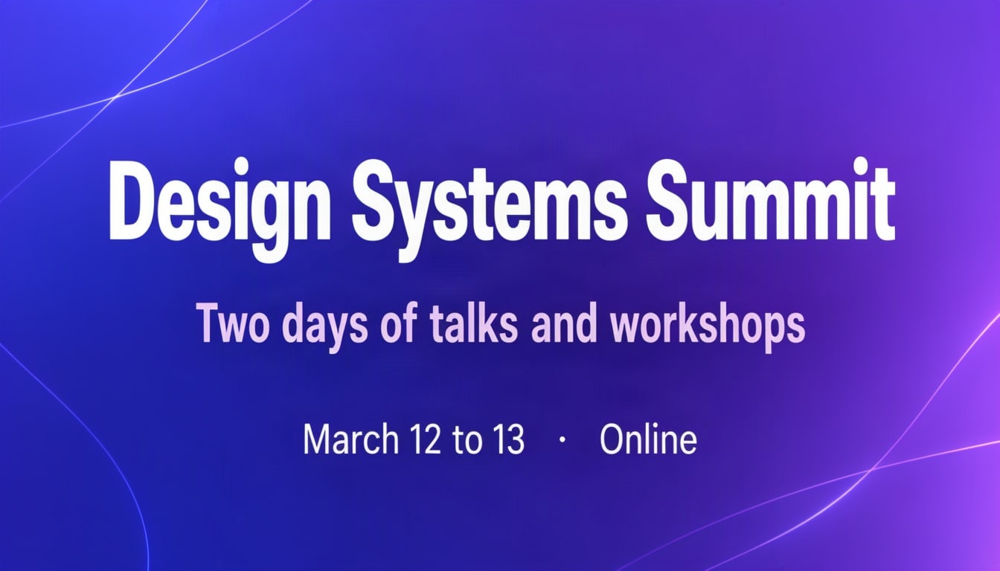

# Conference banner



A wide banner reads in a straight line: title, subtitle, date. Leave the rest of the canvas to the background.

| Canvas | Ratio | Seed | Steps | Guidance |
| --- | --- | --- | --- | --- |
| 1344 × 768 | 16:9 | 1104 | 50 | 3 |

[Open the layout editor](https://mossimage.studio/layout?utm_source=github&utm_medium=referral&utm_campaign=layout_cookbook), pick 16:9, choose **Import JSON** and paste this:

```json
{
  "summary": {
    "meta": [
      "banner"
    ],
    "canvas": "single",
    "caption": "A wide tech conference banner with a smooth indigo to violet gradient background and thin glowing abstract lines."
  },
  "items": [
    {
      "label": "text",
      "caption": "Large bold white sans-serif title.",
      "text": "Design Systems Summit",
      "bbox": [
        -192,
        -544,
        -32,
        544
      ]
    },
    {
      "label": "text",
      "caption": "Medium pale lavender sans-serif subtitle.",
      "text": "Two days of talks and workshops",
      "bbox": [
        16,
        -416,
        96,
        416
      ]
    },
    {
      "label": "text",
      "caption": "Small white sans-serif line.",
      "text": "March 12 to 13  ·  Online",
      "bbox": [
        176,
        -288,
        240,
        288
      ]
    }
  ],
  "bbox_coord_space": "abs_centralized",
  "bbox_format": "yxyx"
}
```
