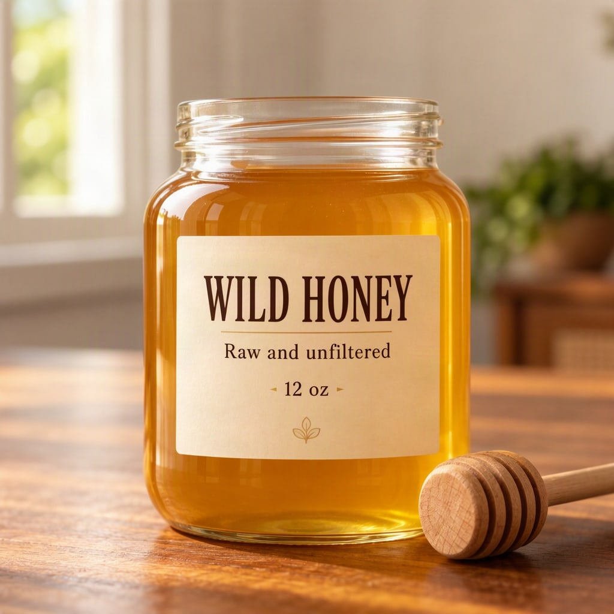

# Honey jar product shot



Describe the jar as an object, then give the label text its own box inside it. The words stay on the product.

| Canvas | Ratio | Seed | Steps | Guidance |
| --- | --- | --- | --- | --- |
| 1024 × 1024 | 1:1 | 1106 | 50 | 3 |

[Open the layout editor](https://mossimage.studio/layout?utm_source=github&utm_medium=referral&utm_campaign=layout_cookbook), pick 1:1, choose **Import JSON** and paste this:

```json
{
  "summary": {
    "meta": [
      "product photo"
    ],
    "canvas": "single",
    "caption": "A studio product photo of a glass honey jar with a cream paper label on a warm wooden table, soft window light and a shallow depth of field."
  },
  "items": [
    {
      "label": "object",
      "caption": "A round glass jar of golden honey with a cream paper label and a wooden dipper beside it.",
      "bbox": [
        -352,
        -272,
        400,
        272
      ]
    },
    {
      "label": "text",
      "caption": "Bold dark brown serif uppercase label title.",
      "text": "WILD HONEY",
      "bbox": [
        -64,
        -176,
        32,
        176
      ]
    },
    {
      "label": "text",
      "caption": "Small dark brown serif label line.",
      "text": "Raw and unfiltered",
      "bbox": [
        48,
        -144,
        96,
        144
      ]
    },
    {
      "label": "text",
      "caption": "Small dark brown serif label line.",
      "text": "12 oz",
      "bbox": [
        112,
        -64,
        160,
        64
      ]
    }
  ],
  "bbox_coord_space": "abs_centralized",
  "bbox_format": "yxyx"
}
```
