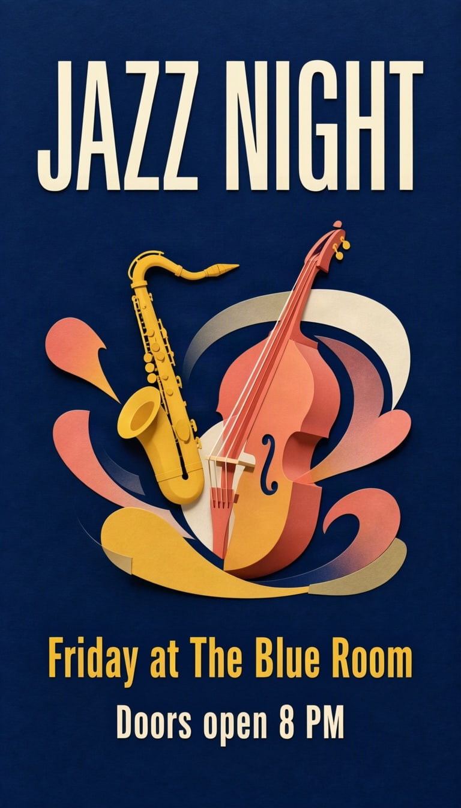

# Jazz night poster



One big title, one illustration, two short lines. The simplest shape a poster can take, and the best place to start.

| Canvas | Ratio | Seed | Steps | Guidance |
| --- | --- | --- | --- | --- |
| 768 × 1344 | 9:16 | 1101 | 50 | 3 |

[Open the layout editor](https://mossimage.studio/layout?utm_source=github&utm_medium=referral&utm_campaign=layout_cookbook), pick 9:16, choose **Import JSON** and paste this:

```json
{
  "summary": {
    "meta": [
      "poster"
    ],
    "canvas": "single",
    "caption": "A bold mid-century modern jazz concert poster on a deep navy background with flat cut-paper shapes in mustard yellow, coral and cream."
  },
  "items": [
    {
      "label": "text",
      "caption": "Huge cream condensed uppercase title.",
      "text": "JAZZ NIGHT",
      "bbox": [
        -576,
        -320,
        -352,
        320
      ]
    },
    {
      "label": "object",
      "caption": "A flat cut-paper illustration of a saxophone and a double bass with curving abstract shapes.",
      "bbox": [
        -304,
        -304,
        320,
        304
      ]
    },
    {
      "label": "text",
      "caption": "Medium mustard yellow sans-serif line.",
      "text": "Friday at The Blue Room",
      "bbox": [
        384,
        -304,
        464,
        304
      ]
    },
    {
      "label": "text",
      "caption": "Small cream sans-serif line.",
      "text": "Doors open 8 PM",
      "bbox": [
        496,
        -192,
        560,
        192
      ]
    }
  ],
  "bbox_coord_space": "abs_centralized",
  "bbox_format": "yxyx"
}
```
