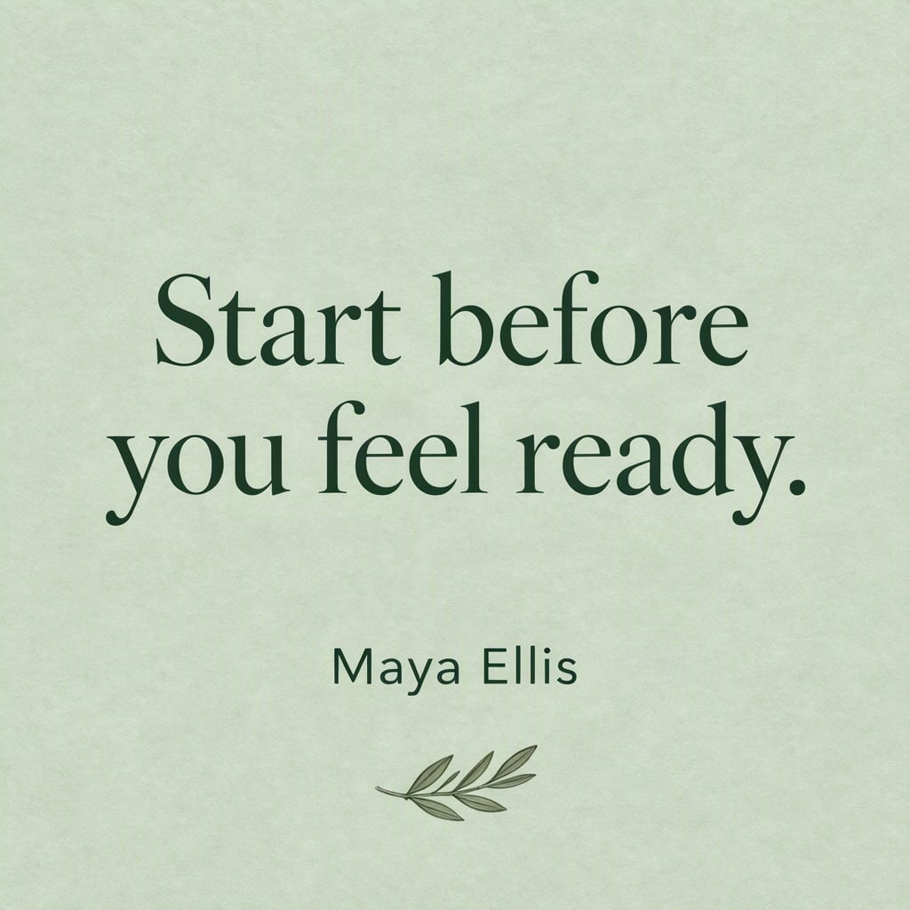

# Quote card



A quote works best when line breaks are yours, not the model's. Give each line its own box.

| Canvas | Ratio | Seed | Steps | Guidance |
| --- | --- | --- | --- | --- |
| 1024 × 1024 | 1:1 | 1107 | 50 | 3 |

[Open the layout editor](https://mossimage.studio/layout?utm_source=github&utm_medium=referral&utm_campaign=layout_cookbook), pick 1:1, choose **Import JSON** and paste this:

```json
{
  "summary": {
    "meta": [
      "social post"
    ],
    "canvas": "single",
    "caption": "A calm square quote card with a soft sage green paper texture and elegant dark green serif type."
  },
  "items": [
    {
      "label": "text",
      "caption": "Large dark green serif line.",
      "text": "Start before",
      "bbox": [
        -224,
        -368,
        -80,
        368
      ]
    },
    {
      "label": "text",
      "caption": "Large dark green serif line.",
      "text": "you feel ready.",
      "bbox": [
        -64,
        -400,
        80,
        400
      ]
    },
    {
      "label": "text",
      "caption": "Small dark green sans-serif line.",
      "text": "Maya Ellis",
      "bbox": [
        208,
        -144,
        272,
        144
      ]
    },
    {
      "label": "object",
      "caption": "A thin hand-drawn sprig of olive leaves.",
      "bbox": [
        320,
        -96,
        416,
        96
      ]
    }
  ],
  "bbox_coord_space": "abs_centralized",
  "bbox_format": "yxyx"
}
```
