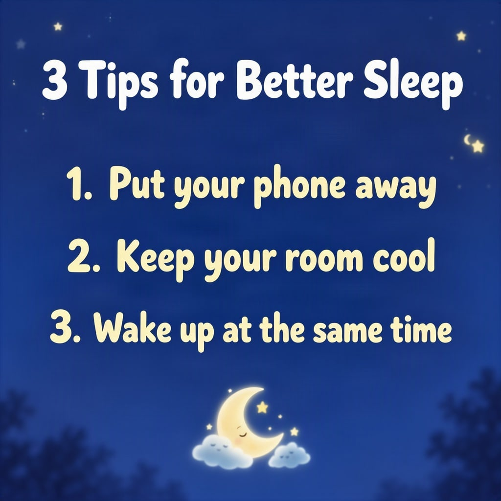

# Tips list for social media



A numbered list is a stack of equal boxes. Equal heights give you equal rhythm.

| Canvas | Ratio | Seed | Steps | Guidance |
| --- | --- | --- | --- | --- |
| 1024 × 1024 | 1:1 | 1108 | 50 | 3 |

[Open the layout editor](https://mossimage.studio/layout?utm_source=github&utm_medium=referral&utm_campaign=layout_cookbook), pick 1:1, choose **Import JSON** and paste this:

```json
{
  "summary": {
    "meta": [
      "social post"
    ],
    "canvas": "single",
    "caption": "A friendly square social media post with a deep blue night sky background, a few soft stars and rounded white type."
  },
  "items": [
    {
      "label": "text",
      "caption": "Large rounded white bold title.",
      "text": "3 Tips for Better Sleep",
      "bbox": [
        -448,
        -432,
        -272,
        432
      ]
    },
    {
      "label": "text",
      "caption": "Medium rounded pale yellow line.",
      "text": "1. Put your phone away",
      "bbox": [
        -176,
        -384,
        -80,
        384
      ]
    },
    {
      "label": "text",
      "caption": "Medium rounded pale yellow line.",
      "text": "2. Keep your room cool",
      "bbox": [
        -32,
        -384,
        64,
        384
      ]
    },
    {
      "label": "text",
      "caption": "Medium rounded pale yellow line.",
      "text": "3. Wake up at the same time",
      "bbox": [
        112,
        -416,
        208,
        416
      ]
    },
    {
      "label": "object",
      "caption": "A small crescent moon with a sleeping cloud.",
      "bbox": [
        272,
        -128,
        448,
        128
      ]
    }
  ],
  "bbox_coord_space": "abs_centralized",
  "bbox_format": "yxyx"
}
```
