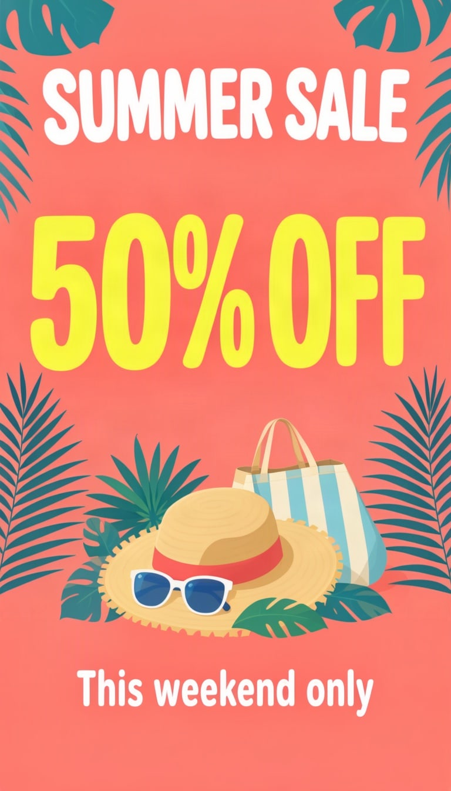

# Summer sale flyer



The number is the message, so its box is the biggest thing on the page. Everything else stays small.

| Canvas | Ratio | Seed | Steps | Guidance |
| --- | --- | --- | --- | --- |
| 768 × 1344 | 9:16 | 1105 | 50 | 3 |

[Open the layout editor](https://mossimage.studio/layout?utm_source=github&utm_medium=referral&utm_campaign=layout_cookbook), pick 9:16, choose **Import JSON** and paste this:

```json
{
  "summary": {
    "meta": [
      "flyer"
    ],
    "canvas": "single",
    "caption": "A cheerful retail sale flyer with a bright coral background, flat tropical leaves and a sunny, playful style."
  },
  "items": [
    {
      "label": "text",
      "caption": "Large white rounded uppercase title.",
      "text": "SUMMER SALE",
      "bbox": [
        -576,
        -320,
        -416,
        320
      ]
    },
    {
      "label": "text",
      "caption": "Enormous bright yellow bold sans-serif number.",
      "text": "50% OFF",
      "bbox": [
        -320,
        -336,
        -32,
        336
      ]
    },
    {
      "label": "object",
      "caption": "A flat illustration of a straw hat, sunglasses and a beach bag surrounded by palm leaves.",
      "bbox": [
        32,
        -288,
        416,
        288
      ]
    },
    {
      "label": "text",
      "caption": "Medium white sans-serif line.",
      "text": "This weekend only",
      "bbox": [
        464,
        -256,
        544,
        256
      ]
    }
  ],
  "bbox_coord_space": "abs_centralized",
  "bbox_format": "yxyx"
}
```
