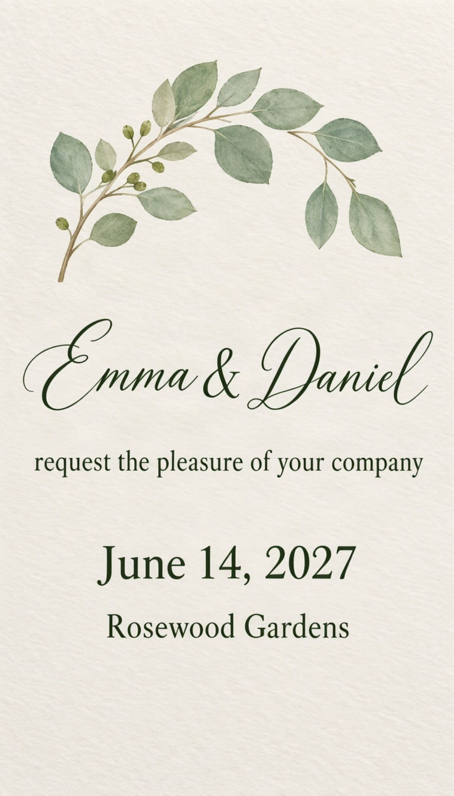

# Wedding invitation



Names first, details after. Formal cards need more empty space than you think, so use fewer boxes.

| Canvas | Ratio | Seed | Steps | Guidance |
| --- | --- | --- | --- | --- |
| 768 × 1344 | 9:16 | 1115 | 50 | 3 |

[Open the layout editor](https://mossimage.studio/layout?utm_source=github&utm_medium=referral&utm_campaign=layout_cookbook), pick 9:16, choose **Import JSON** and paste this:

```json
{
  "summary": {
    "meta": [
      "invitation"
    ],
    "canvas": "single",
    "caption": "An elegant wedding invitation on textured ivory card with delicate watercolor eucalyptus leaves and fine dark green script and serif type."
  },
  "items": [
    {
      "label": "object",
      "caption": "A delicate watercolor wreath of eucalyptus leaves.",
      "bbox": [
        -576,
        -304,
        -192,
        304
      ]
    },
    {
      "label": "text",
      "caption": "Large dark green flowing script names.",
      "text": "Emma & Daniel",
      "bbox": [
        -144,
        -352,
        32,
        352
      ]
    },
    {
      "label": "text",
      "caption": "Small dark green serif line.",
      "text": "request the pleasure of your company",
      "bbox": [
        80,
        -336,
        144,
        336
      ]
    },
    {
      "label": "text",
      "caption": "Medium dark green serif line.",
      "text": "June 14, 2027",
      "bbox": [
        240,
        -224,
        320,
        224
      ]
    },
    {
      "label": "text",
      "caption": "Small dark green serif line.",
      "text": "Rosewood Gardens",
      "bbox": [
        352,
        -208,
        416,
        208
      ]
    }
  ],
  "bbox_coord_space": "abs_centralized",
  "bbox_format": "yxyx"
}
```
