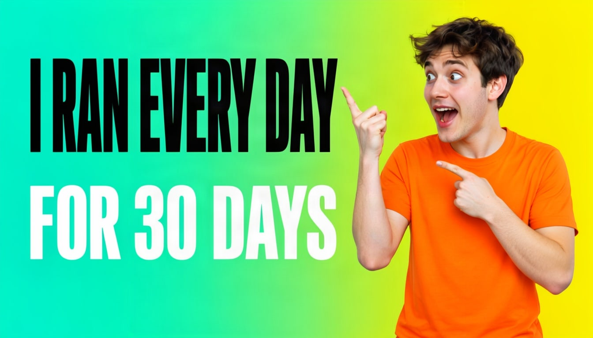

# YouTube thumbnail



Large words on one side, a face on the other. A character box keeps the person and the title from overlapping.

| Canvas | Ratio | Seed | Steps | Guidance |
| --- | --- | --- | --- | --- |
| 1344 × 768 | 16:9 | 1113 | 50 | 3 |

[Open the layout editor](https://mossimage.studio/layout?utm_source=github&utm_medium=referral&utm_campaign=layout_cookbook), pick 16:9, choose **Import JSON** and paste this:

```json
{
  "summary": {
    "meta": [
      "thumbnail"
    ],
    "canvas": "single",
    "caption": "A high-energy YouTube thumbnail with a saturated teal to yellow gradient background and sharp, bright lighting."
  },
  "items": [
    {
      "label": "text",
      "caption": "Huge heavy black uppercase sans-serif title with clear spacing between letters.",
      "text": "I RAN EVERY DAY",
      "bbox": [
        -256,
        -608,
        -32,
        96
      ]
    },
    {
      "label": "text",
      "caption": "Large heavy white uppercase sans-serif line with clear spacing between letters.",
      "text": "FOR 30 DAYS",
      "bbox": [
        32,
        -608,
        208,
        96
      ]
    },
    {
      "label": "character",
      "caption": "An excited young man in a plain solid orange t-shirt with no logos, pointing at the words, with a surprised expression.",
      "bbox": [
        -352,
        128,
        384,
        640
      ]
    }
  ],
  "bbox_coord_space": "abs_centralized",
  "bbox_format": "yxyx"
}
```
