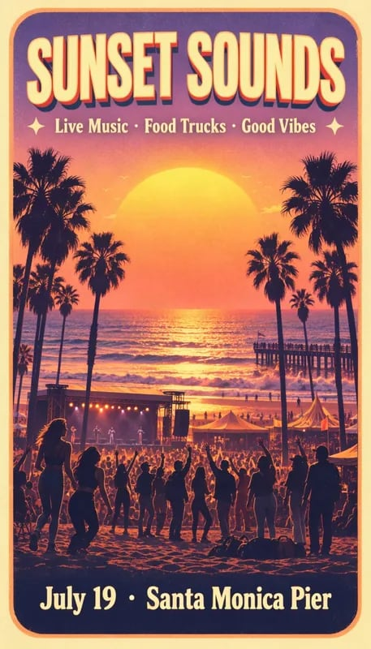
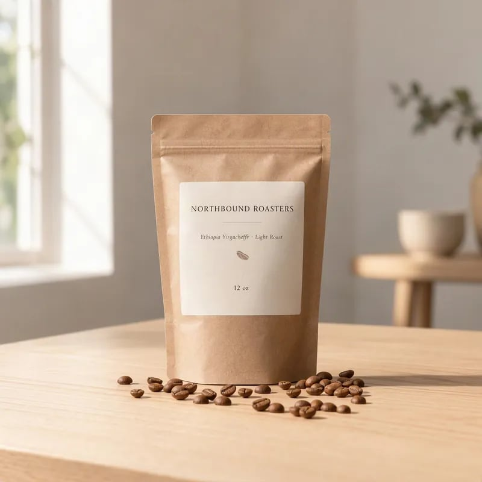
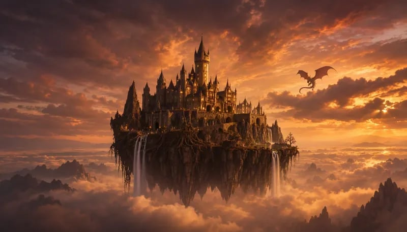
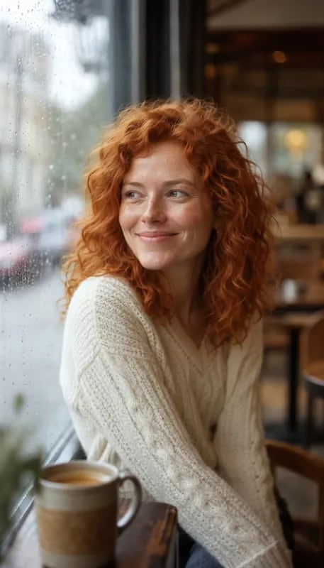
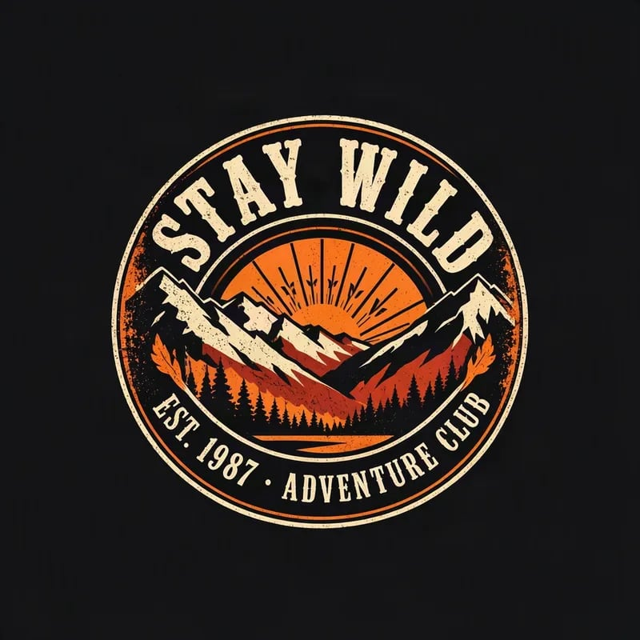
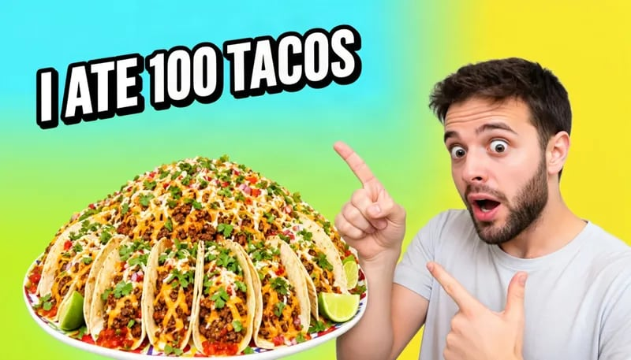
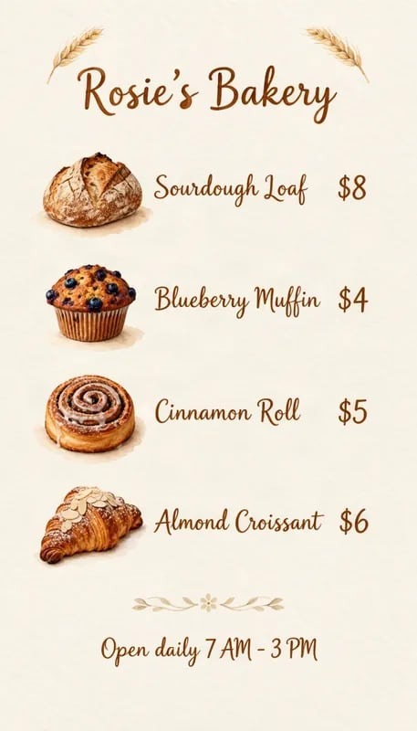
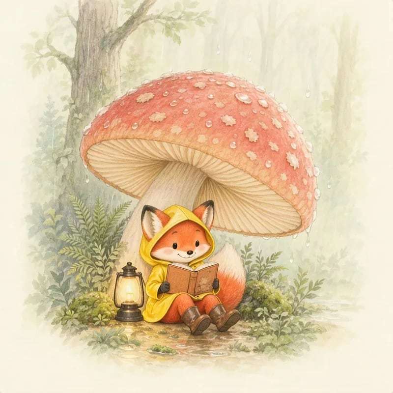
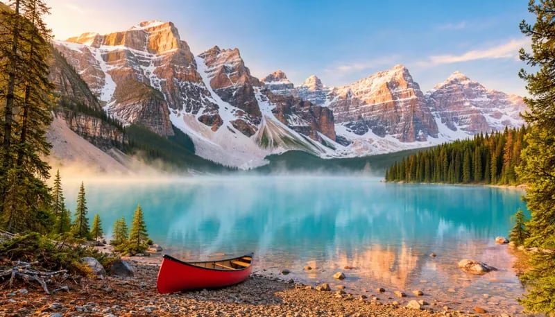
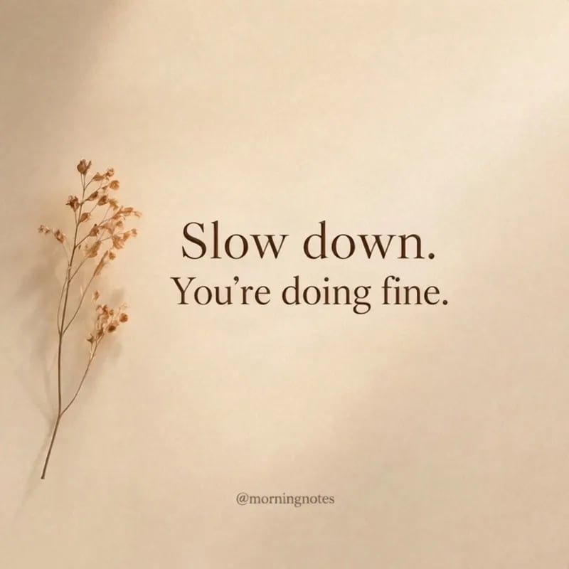

# Text prompt examples

Ten plain text prompts for MOSS-Image, each with the image it produced. Put the exact words you want in quotes. These ran with prompt expansion on, at 50 steps and guidance 3.

[Try a prompt in your browser](https://mossimage.studio/?utm_source=github&utm_medium=referral&utm_campaign=layout_cookbook).

## Music festival poster



```text
A bold summer music festival poster. Huge retro title "SUNSET SOUNDS" at the top, the line "Live Music · Food Trucks · Good Vibes" below it, an illustrated palm-lined beach at golden hour with a crowd in front of a small stage, and a footer reading "July 19 · Santa Monica Pier". Warm orange, pink and purple gradient, screen-print texture.
```

## Coffee bag label



```text
A studio product photo of a matte kraft-paper coffee bag standing on a light oak table. The label reads "NORTHBOUND ROASTERS" in a clean serif font, with "Ethiopia Yirgacheffe · Light Roast" and "12 oz" in smaller text below. A few scattered coffee beans, soft window light, minimal and premium.
```

## Fantasy concept art



```text
Epic fantasy concept art of a castle on a floating cliff above the clouds at dusk, waterfalls pouring off the edge, a dragon circling in the distance, dramatic golden light, painterly digital art. No text.
```

## Portrait photo



```text
A natural-light portrait photo of a woman in her thirties with curly red hair and freckles, wearing a chunky knit sweater, smiling softly as she sits by a cafe window on a rainy day. 85mm lens, shallow depth of field, subtle film grain. No text.
```

## T-shirt graphic



```text
A vintage t-shirt graphic on a plain black background: a round retro badge with mountains and a rising sun, the arched text "STAY WILD" on top and "EST. 1987 · ADVENTURE CLUB" below. Distressed screen-print style in cream and orange.
```

## YouTube thumbnail



```text
A YouTube video thumbnail. A surprised young man with a short beard on the right, pointing at a giant plate of tacos on the left. Huge bold white text with a thick black outline reading "I ATE 100 TACOS" across the top left. Bright saturated colors, high contrast, clean background.
```

## Bakery price list



```text
A friendly bakery flyer on cream paper. Title "Rosie's Bakery" in hand-lettered script at the top, then a price list: "Sourdough Loaf $8", "Blueberry Muffin $4", "Cinnamon Roll $5", "Almond Croissant $6". Watercolor illustrations of bread and pastries, and a footer reading "Open daily 7 AM - 3 PM".
```

## Storybook illustration



```text
A whimsical children's storybook illustration of a small fox in a yellow raincoat reading a book under a giant mushroom while rain falls in a cozy forest. Soft watercolor and colored pencil, warm gentle colors. No text.
```

## Landscape photo



```text
A wide landscape photograph of a turquoise glacial lake surrounded by snowy mountain peaks at sunrise, pine forest in the foreground, mist over the water and a small red canoe on the shore. Crisp and highly detailed, nature magazine style. No text.
```

## Instagram quote post



```text
A square Instagram quote post. Soft beige background with a single dried flower stem on the left. Centered elegant serif text on two lines reading "Slow down." and "You're doing fine.", with a small handle "@morningnotes" at the bottom. Minimal, calm, lots of empty space.
```
